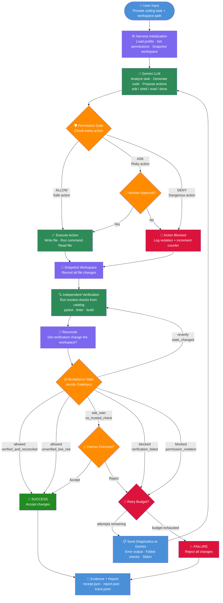

# Harness Workflow

Complete workflow of the OpenCode + Gemini Agent Harness — from user input to final report.

---

## Workflow Diagram



---

## Step-by-Step Explanation

### Step 1 — User Input
You provide two things:
- A **task** in plain English — e.g. `"Create a Flask web app with home and login page"`
- A **workspace path** — the folder where files will be created — e.g. `C:\Temp\myproject`

```powershell
python -m harness.entry "YOUR TASK" C:\Temp\myproject --non-interactive --profile profiles/autonomous.yaml
```

---

### Step 2 — Harness Initialization
The harness:
- Loads your **profile** (`safe` / `default` / `autonomous` / `benchmark`)
- Sets **permission rules** — which commands are ALLOW / ASK / DENY
- Takes a **before snapshot** of the workspace (SHA-256 fingerprint of every file)

---

### Step 3 — Gemini LLM
Gemini receives your task and responds with a structured JSON plan:

```json
{
  "explanation": "I will create hello.py with a print statement",
  "actions": [
    { "kind": "edit", "path": "hello.py", "content": "print('Hello World')" },
    { "kind": "done" }
  ]
}
```

Action types Gemini can propose:

| Kind | What it does |
|------|-------------|
| `edit` | Create or modify a file |
| `read` | Read a file for context |
| `shell` | Run a terminal command |
| `done` | Task is complete |

---

### Step 4 — Permission Gate
**Every single action** is checked before execution:

| Verdict | When | Example |
|---------|------|---------|
| ✅ ALLOW | Safe, matches a rule | `edit *.py` |
| ❓ ASK | Risky, needs human approval | `git push` |
| ❌ DENY | Dangerous, no rule matches | `rm -rf /` |

Default is **DENY** — if no rule matches, the action is blocked.

---

### Step 5 — Controlled Execution
Only approved actions run. Each execution is:
- Logged with timestamp
- Recorded in the tamper-proof trace
- Limited by timeouts and resource limits

---

### Step 6 — Independent Verification
After execution, the harness runs **trusted checks** from a catalog (if provided):
- `pytest` — runs your test suite
- Linters — checks code quality
- Build checks — confirms the code compiles/runs

These checks run **independently of Gemini** — Gemini cannot fake a passing test.

---

### Step 7 — Acceptance Gate
A **pure function** (`decide()`) makes the final call based purely on evidence:

| Decision | State | Meaning |
|----------|-------|---------|
| ✅ `allowed` | `verified_and_reconciled` | Tests passed, changes accepted |
| ✅ `allowed` | `unverified_low_risk` | No tests but low-risk change, auto-approved |
| ❓ `ask_user` | `no_trusted_check` | No test catalog, needs human approval |
| ❌ `blocked` | `verification_failed` | Tests failed |
| ❌ `blocked` | `permission_violation` | Gemini tried something dangerous |

---

### Step 8 — Repair Loop
If blocked and retry budget allows:
- Harness sends **diagnostics** (error output, failed test results) back to Gemini
- Gemini analyzes the failure and proposes a fix
- Loop repeats up to `max_attempts` times (default: 4)

---

### Step 9 — Evidence and Report
Every run produces 3 files inside `.harness/job-xxxxx/`:

| File | What it contains |
|------|-----------------|
| `report.json` | Final decision, changed files, token usage, cost |
| `trace.jsonl` | Every action step-by-step, hash-chained (tamper-proof) |
| Receipt in report | SHA-256 fingerprint binding the decision to the exact workspace state |

---

## Output Folder Structure

```
C:\Temp\myproject\
├── hello.py                        ← file Gemini created
└── .harness\
    └── job-abc123\
        ├── report.json             ← check this first
        └── trace.jsonl             ← full step-by-step log
```

---

## Quick Reference Commands

```powershell
# Set API key
$env:GEMINI_API_KEY = "your-key-here"

# Run a task
python -m harness.entry "YOUR TASK" C:\Temp\myproject --non-interactive --allow-shell python --profile profiles/autonomous.yaml

# Check result
Get-Content "C:\Temp\myproject\.harness\$(Get-ChildItem C:\Temp\myproject\.harness | Select-Object -Last 1 -ExpandProperty Name)\report.json"

# Run created file
python C:\Temp\myproject\hello.py

# Run all tests
python -m pytest tests/ -q
```
